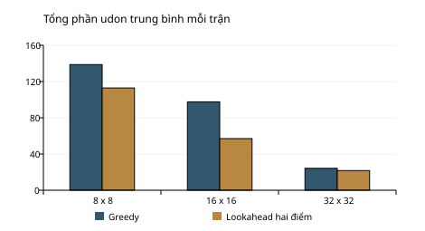

# Xây dựng môi trường mô phỏng và đánh giá các phương pháp lập kế hoạch đa tác tử trên bản đồ lục giác có ràng buộc tài nguyên

BÁO CÁO BÀI TẬP LỚN MÔN THUẬT TOÁN ỨNG DỤNG

Đề tài được xây dựng từ bài toán HEXUDON của Procon Việt Nam 2026.

## Tóm tắt

Trong bài tập lớn này, chúng em xây dựng một chương trình lập kế hoạch cho nhiều xe cùng hoạt động trên bản đồ lục giác. Xe tuần tra có nhiệm vụ ghé các điểm để thu thập udon, còn xe tiếp nhiên liệu hỗ trợ các xe tuần tra duy trì hoạt động qua nhiều ngày. Một kế hoạch tốt cần quan tâm đồng thời đến thời gian di chuyển, mức nhiên liệu còn lại, sự khác nhau giữa các loại udon và tình trạng giao thông. Vì vậy, bài toán phù hợp để vận dụng các kiến thức về đồ thị, tìm kiếm và thiết kế thuật toán heuristic trong học phần Thuật toán ứng dụng.

Chương trình gồm hai lớp giải quyết. Ở lớp tìm đường, chúng em cài đặt DFS, BFS, Dijkstra, Greedy Best-First và A* để so sánh khả năng tìm đường dưới ràng buộc tài nguyên. Ở lớp lập kế hoạch, chúng em triển khai Greedy và Lookahead hai điểm, kết hợp với một cơ chế hẹn gặp xe tiếp tế. Mọi kế hoạch đều được kiểm tra bằng mô phỏng trước khi xuất thành mảng lệnh. Bộ kiểm tra đặc biệt chú ý đến trường hợp xe không còn đủ step để hoàn thành một lệnh di chuyển vào cuối ngày.

Phần thực nghiệm sử dụng bản đồ 8×8, 16×16 và 32×32, với dữ liệu gốc và seed được lưu để đối chiếu. Báo cáo phân biệt rõ kết quả tìm đường với kết quả toàn trận, đồng thời trình bày cả những trường hợp Lookahead chưa mang lại cải thiện. Simulator hiện hỗ trợ nhiều đội và đã được đối chiếu với replay thực của BTC trong chế độ luyện tập một đội. Phần nhiều đội có kiểm thử nội bộ nhưng chưa được đối chiếu bằng replay BTC. Báo cáo phân biệt phạm vi đã xác minh với những trường hợp chưa đủ bằng chứng.

## 1 Giới thiệu đề tài

### 1.1 Lý do lựa chọn

Trong nhiều bài toán thực tế, việc tìm một tuyến đường ngắn chưa đủ để tạo ra một kế hoạch hiệu quả. Một đội giao nhận hoặc một nhóm phương tiện kiểm tra hiện trường còn phải chia nhiệm vụ, cân đối nhiên liệu và phối hợp tại những vị trí thích hợp. Bài toán HEXUDON thể hiện được các đặc điểm đó thông qua luật chơi tương đối trực quan, trong khi quy mô bản đồ vẫn đủ lớn để cách thử tất cả phương án trở nên không khả thi.

Chúng em lựa chọn bài toán này vì có thể xây dựng một quá trình giải từ đơn giản đến nâng cao. Ban đầu, mỗi tuyến di chuyển được xem như một đường đi trên đồ thị. Sau đó, các tuyến được ghép thành kế hoạch ngày và kế hoạch nhiều ngày. Cách triển khai này giúp chúng em thấy rõ vai trò của từng thuật toán và tránh đánh đồng việc tìm được đường với việc giải được toàn bộ bài toán.

### 1.2 Mục tiêu và phạm vi

Mục tiêu thứ nhất của đề tài là mô hình hóa chính xác những luật đã được công bố, đặc biệt là chi phí di chuyển theo ô xuất phát, giới hạn nhiên liệu và quỹ bước độc lập của từng xe. Mục tiêu thứ hai là cài đặt các thuật toán theo cách dễ đọc, có thể giải thích trong quá trình báo cáo. Mục tiêu thứ ba là đánh giá chất lượng lời giải và thời gian chạy bằng thực nghiệm thay vì chỉ nhận xét theo cảm tính.

Chúng em triển khai các thuật toán bằng Python và dành một phần trọng tâm cho việc xây dựng, kiểm chứng simulator. Phiên bản hiện tại đã có bộ thực thi nhiều đội, bộ kiểm thử và chương trình đối chiếu API. Các phép đo so sánh chiến lược vẫn chạy một đội để giữ điều kiện rõ ràng. Học tăng cường là hướng mở rộng dự kiến sau khi nền mô phỏng đủ tin cậy; bản báo cáo này chưa có mô hình RL được huấn luyện hoặc kết quả RL.

### 1.3 Các sản phẩm của đề tài

Sản phẩm của bài tập lớn gồm mã nguồn tìm đường và lập kế hoạch, bộ mô phỏng kiêm kiểm tra output, bộ sinh bản đồ liên thông, các phép kiểm thử và chương trình thực nghiệm. Ngoài ra, chương trình có thể xuất replay dạng JSON để xem lại vị trí và nhiên liệu của xe theo từng step. Báo cáo này giải thích các lựa chọn thiết kế, trình bày số liệu đo và chỉ ra những giới hạn còn tồn tại.

## 2 Phân tích bài toán và các quy tắc

### 2.1 Bản đồ và phương tiện

Theo đề chính thức [1], bản đồ gồm các ô lục giác, có chiều rộng và chiều cao từ 8 đến 32. Mỗi ô thuộc một trong bốn loại địa hình là đồng bằng, đường bộ, núi hoặc ao. Các ô có thể di chuyển được đều liên thông. Chúng em loại ao khỏi tập đỉnh có thể đi qua và tạo cạnh giữa những ô kề hợp lệ.

Mỗi đội điều khiển từ 3 đến 8 xe và chọn loại cho từng xe trước trận. Xe tuần tra có thể lấy udon nhưng phải sử dụng nhiên liệu khi di chuyển. Xe tiếp nhiên liệu không lấy udon, không tiêu thụ nhiên liệu và có thể nạp đầy cho xe tuần tra khi hai xe cùng ô đủ thời gian theo luật. Loại xe được giữ cố định trong toàn trận.

Một trận kéo dài từ 4 đến 10 ngày. Quỹ step có thể thay đổi theo ngày, nhưng trong một ngày mỗi xe đều có toàn bộ quỹ riêng và các xe hoạt động đồng thời. Do đó, chúng em không chia tổng step của ngày cho số xe, vì cách chia đó sẽ làm sai mô hình thời gian của đề.

### 2.2 Chi phí di chuyển và nhiên liệu

| Ô xuất phát | Step để sang ô kề | Nhiên liệu của xe tuần tra |
|---|---:|---:|
| Đồng bằng | 2 | 1 |
| Núi | 3 | 2 |
| Đường thông thoáng | 1 | 2 |
| Đường đông đúc | 2 | 2 |
| Đường ùn tắc | 4 | 2 |
| Ao | Không được di chuyển vào | Không áp dụng |

Bảng chi phí cho thấy đường ít step chưa chắc là đường ít nhiên liệu. Chẳng hạn, xe có thể đi nhanh trên đường bộ thông thoáng nhưng phải tiêu thụ nhiều nhiên liệu hơn so với việc rời ô đồng bằng. Khi nhiên liệu gần hết, một tuyến chậm hơn vẫn có thể là lựa chọn duy nhất để đến đích hợp lệ. Đây là lý do chúng em không chỉ lưu một khoảng cách duy nhất tại mỗi ô trong bài toán tìm đường có ràng buộc.

Chi phí được tính tại ô xuất phát của từng lệnh. Ví dụ, xe đi từ đồng bằng sang núi sẽ mất 2 step cho lần di chuyển đó. Chỉ khi tiếp tục rời ô núi, xe mới phải trả chi phí 3 step. Chương trình dùng chung hàm tính chi phí giữa bộ tìm đường và simulator để tránh hai cách hiểu khác nhau.

### 2.3 Cách biểu diễn output

Mỗi xe có một mảng lệnh. Các số nguyên từ 0 đến 5 biểu thị sáu hướng, lần lượt là trên trái, trên phải, phải, dưới phải, dưới trái và trái. Số nguyên âm -k biểu thị việc đứng chờ k step. Thứ tự các mảng phải trùng với thứ tự xe trong cấu hình và trạng thái ngày [2], [3].

Ví dụ, mảng [2, 5, -224] yêu cầu xe đi sang phải một ô, quay sang trái một ô rồi chờ 224 step. Nếu hai ô xuất phát của hai lệnh đều là đồng bằng, tổng thời gian sẽ bằng 2 + 2 + 224 = 228 step. Vì một mã hướng chỉ mô tả một lần sang ô kề, số phần tử của mảng không phải là tổng số step.

Điều kiện cuối ngày cần được kiểm tra chặt chẽ. Nếu xe chỉ còn 2 step nhưng đang ở núi, chương trình không được phát lệnh di chuyển có chi phí 3 step. Bộ lập kế hoạch phải kết thúc bằng lệnh chờ -2. Một kế hoạch hợp lệ phải sử dụng đúng quỹ bước của từng xe, không chỉ nhỏ hơn hoặc bằng quỹ đó.

### 2.4 Thu thập udon và thứ tự mục tiêu

Mỗi điểm udon nằm trên đồng bằng, thuộc một chuỗi và có kho tối đa riêng. Một xe tuần tra chỉ lấy tối đa một phần tại mỗi điểm trong một ngày, dù có ghé lại nhiều lần. Kho được bổ sung đầu ngày và độc lập giữa các đội. Vị trí cùng nhiên liệu cuối ngày được giữ sang ngày sau.

Thứ hạng được xét theo thứ tự ưu tiên: số loại udon khác nhau trong toàn trận, tổng số loại khác nhau thu từng ngày, tổng số phần và thời gian phản hồi. Chúng em biểu diễn ba tiêu chí thu thập bằng bộ điểm (U, D, Q) và so sánh theo thứ tự từ trái sang phải. Chẳng hạn, điểm (10, 20, 30) được xem là tốt hơn (9, 100, 200), vì tiêu chí đầu tiên có ưu tiên cao nhất. Chương trình không gộp các tiêu chí này bằng những trọng số tùy ý có thể làm đảo ngược luật xếp hạng.

### 2.5 Giao thông và dữ liệu đầu ngày

Lưu lượng một ô đường được xác định từ tổng thời gian các xe hiện diện tại ô đó trong hai ngày trước, sau đó chia cho số đội. Các ngưỡng đông đúc và ùn tắc được cung cấp trong cấu hình. Ngày đầu tất cả đường đều thông thoáng, còn giao thông của ngày thứ hai chỉ phụ thuộc ngày đầu. Trạng thái đường cố định trong một ngày [1].

File input_sample.json chứa địa hình gốc, các điểm udon và thông số trận, nhưng không có trường traffics. Dữ liệu giao thông từng ngày nằm trong bản tin trạng thái theo schema kỹ thuật. Vì vậy, chương trình không suy diễn giao thông của một ngày bất kỳ chỉ từ file cấu hình ban đầu. Trong lệnh plan cho ngày sau ngày đầu, người dùng cần cung cấp trạng thái gồm vị trí, nhiên liệu và giao thông hiện tại.

### 2.6 Các quy ước cần công bố

Đề và tài liệu kỹ thuật chưa mô tả đầy đủ mọi trường hợp biên của timeline. Vì vậy, chúng em dùng API BTC để xác minh bằng những kế hoạch có mục đích riêng, thay vì giữ các giả định ban đầu. Replay ghi vị trí xe tại ô nguồn khi chặng đi chưa hoàn thành và chỉ cập nhật nhiên liệu khi xe đến ô đích. Sau khi cập nhật vị trí, máy chủ xử lý tiếp tế và thu hàng trong cùng frame. Khi một xe đến ô có xe tiếp tế đúng step cuối ngày, nhiên liệu vẫn được nạp đầy trong frame đó [4], [6].

Frame 0 giữ nguyên trạng thái đầu ngày, chưa ghi nhận thu hàng. Nếu xe đứng sẵn tại điểm udon và chờ, lần thu đầu tiên xuất hiện ở frame 1. Nhiều xe có thể tạo nhiều sự kiện cùng một vị trí trong frame đó, miễn còn kho. Những chi tiết này đã được đưa vào kiểm thử hồi quy từ dữ liệu API.

Giao thông có một hành vi biên cần tách khỏi cách diễn giải luật chung. Khi xe bắt đầu ngày trên ô đường, khoảng chuyển tiếp rời vị trí đầu ngày không được đếm giống các frame hiển thị ở ô nguồn. Sau lần đến ô đầu tiên trong ngày, khoảng chuyển tiếp được tính theo vị trí hiển thị. Chúng em tái hiện hiện tượng này bằng hai biến thể Q10 và một ca Q02, rồi điều chỉnh simulator để khớp phiên bản máy chủ đã thử. Báo cáo ghi đây là hành vi quan sát được, không xem nó là một điều luật mới do BTC công bố.

Quy tắc ưu tiên theo chỉ số xe khi kho không đủ và trường hợp xe đã cạn nhiên liệu hoàn toàn cùng xe tiếp tế vẫn cần thêm bằng chứng trực tiếp. Chương trình đã có kiểm thử nội bộ cho các trường hợp này, nhưng không gộp chúng vào phần đã được API xác nhận. Chi tiết truy cập và tệp đối chiếu nằm trong api_manual_check.md.

## 3 Mô hình hóa bài toán

### 3.1 Đồ thị có trọng số theo ngày

Chúng em biểu diễn bản đồ bằng đồ thị G = (V, E). Tập V gồm những ô không phải ao. Mỗi cạnh có hướng (u, v) tồn tại khi v là một ô kề có thể đi vào từ u. Mỗi đỉnh có tối đa sáu cạnh đi ra, vì vậy E không vượt quá 6V. Đồ thị không cần lưu thành một ma trận kề đầy đủ; chương trình tính láng giềng khi cần để mã nguồn gọn hơn.

Trong ngày d, cạnh rời u có chi phí thời gian t_d(u) và chi phí nhiên liệu f(u). Các chi phí thời gian thay đổi giữa các ngày đối với ô đường, nhưng giữ nguyên trong ngày. Mặc dù hai ô kề nhau có thể đi qua theo cả hai chiều, trọng số hai chiều có thể khác nhau do địa hình nguồn khác nhau.

Một đường đi P hợp lệ cho xe tuần tra phải thỏa mãn tổng thời gian không vượt ngân sách bước và tổng nhiên liệu không vượt lượng nhiên liệu đang có. Tìm đường một chặng không mô hình hóa việc tiếp tế giữa đường; việc nối các chặng trước và sau điểm tiếp tế thuộc lớp lập kế hoạch. Cách phân chia này giúp phần tìm đường vẫn dễ hiểu và dễ đánh giá độc lập.

### 3.2 Tọa độ và khoảng cách lục giác

Vị trí ô được đánh số theo hàng: pos = row × width + col. Chương trình sử dụng hàng bắt đầu bằng 0 và cột bắt đầu bằng 0. Theo hình bản đồ, hàng chẵn lệch sang phải so với hàng lẻ. Vì vậy, các hướng chéo của hai loại hàng có độ lệch cột khác nhau.

| Hướng | Tên hướng | Độ lệch hàng | Độ lệch cột ở hàng chẵn | Độ lệch cột ở hàng lẻ |
|---|---|---:|---:|---:|
| 0 | Trên trái | -1 | 0 | -1 |
| 1 | Trên phải | -1 | 1 | 0 |
| 2 | Phải | 0 | 1 | 1 |
| 3 | Dưới phải | 1 | 1 | 0 |
| 4 | Dưới trái | 1 | 0 | -1 |
| 5 | Trái | 0 | -1 | -1 |

Để tính heuristic, chúng em chuyển tọa độ hàng cột sang ba tọa độ có tổng bằng 0. Công thức được sử dụng là q = col - (row + row mod 2) // 2, r = row và s = -q - r. Khoảng cách lục giác giữa hai ô bằng giá trị lớn nhất trong ba độ chênh tuyệt đối của q, r và s. Mỗi lần đi sang ô kề có khoảng cách bằng 1, do đó công thức phù hợp để ước lượng số lần di chuyển tối thiểu khi chưa xét ao.

### 3.3 Trạng thái tìm đường và quan hệ trội

Một nhãn tìm đường lưu vị trí, số step đã dùng, nhiên liệu đã dùng, số cạnh đã đi, nhãn cha và hướng từ cha. Hai đường cùng đến một ô có thể khác nhau về thời gian và nhiên liệu. Nếu đường thứ nhất nhanh hơn nhưng tốn nhiều nhiên liệu hơn, cả hai nhãn đều có thể cần được giữ lại.

Đối với Dijkstra và A*, nhãn a trội nhãn b khi a không tốn nhiều step hơn và cũng không tốn nhiều nhiên liệu hơn. Khi đó, mọi phần đường có thể nối tiếp từ b cũng có thể nối từ a với tài nguyên không kém. Chúng em có thể bỏ b mà không làm mất một lời giải có thời gian tốt hơn. Đối với BFS, điều kiện trội còn xét số cạnh, vì mục tiêu của BFS là tối thiểu số lần đi sang ô kề.

Ví dụ, tại cùng ô, nhãn (5 step, 6 nhiên liệu) và nhãn (7 step, 4 nhiên liệu) không trội nhau. Nếu phần đường còn lại cần thêm 3 nhiên liệu trong khi giới hạn là 8, chỉ nhãn thứ hai có thể tiếp tục. Việc lưu một khoảng cách duy nhất tại ô sẽ bỏ nhầm phương án này.

### 3.4 Trạng thái toàn trận

Trạng thái toàn trận gồm danh sách xe, giao thông hiện tại, tập loại udon đã thu, tổng loại theo ngày, tổng phần và lịch sử hiện diện trên đường của hai ngày gần nhất. Mỗi xe lưu loại, vị trí và nhiên liệu. Kho và tập điểm đã ghé của từng xe được khởi tạo lại cho mỗi ngày.

Trong bài toán tối ưu đầy đủ, quyết định của một xe ảnh hưởng tới cơ hội thu thập và lịch tiếp tế của xe khác. Ngoài ra, vị trí cuối ngày còn ảnh hưởng ngày tiếp theo. Không gian trạng thái vì vậy tăng rất nhanh khi số xe và độ dài kế hoạch tăng. Chúng em sử dụng heuristic có giới hạn thay vì tìm tối ưu toàn cục bằng cách liệt kê mọi chuỗi hành động.

## 4 Thiết kế các thuật toán tìm đường

### 4.1 Thuật toán DFS

DFS sử dụng ngăn xếp để ưu tiên mở rộng nhánh vừa được phát hiện. Thuật toán kiểm tra ngân sách trước khi tạo nhãn mới và dùng quan hệ trội để loại các trạng thái không còn hữu ích. Khi gặp đích, chương trình truy ngược nhãn cha để tạo chuỗi hướng di chuyển.

Ưu điểm của DFS là cách cài đặt đơn giản và giúp minh họa rõ cơ chế duyệt sâu. Tuy nhiên, thứ tự các hướng có thể đưa thuật toán vào nhiều đường vòng trước khi đến đích. DFS không bảo đảm đường ít cạnh, ít step hay ít nhiên liệu nhất. Trong đề tài, chúng em sử dụng DFS như một mốc so sánh cơ bản, không chọn nó làm bộ tìm đường mặc định.

### 4.2 Thuật toán BFS

BFS sử dụng hàng đợi và mở rộng theo số cạnh. Trong đồ thị không trọng số, thuật toán tìm được đường có ít cạnh nhất. Khi bổ sung giới hạn step và nhiên liệu, chương trình vẫn giữ nhiều nhãn tài nguyên, đồng thời đưa số cạnh vào điều kiện trội. Nếu không bị cắt bởi hạn giờ, đích đầu tiên được lấy khỏi hàng đợi sẽ có số cạnh nhỏ nhất trong các đường khả thi.

Tuy nhiên, ít cạnh không đồng nghĩa với ít thời gian trong bài toán này. Một tuyến ngắn về số ô có thể đi qua nhiều núi hoặc đường ùn tắc. Do đó, báo cáo ghi riêng số cạnh và số step để tránh kết luận nhầm rằng BFS tối ưu cùng tiêu chí với Dijkstra.

### 4.3 Thuật toán Dijkstra

Dijkstra sử dụng hàng đợi ưu tiên theo tổng step đã dùng. Vì mọi chi phí di chuyển đều dương, thuật toán xử lý nhãn có thời gian nhỏ nhất trước. Khi nhiều nhãn không trội nhau cùng tồn tại tại một ô, từng nhãn có thể được đưa vào hàng đợi. Nhãn đã bị một nhãn tốt hơn loại khỏi danh sách hoạt động sẽ được bỏ qua khi lấy ra.

Khi không bị giới hạn thời gian thực thi, Dijkstra tìm đường ít step nhất trong giới hạn nhiên liệu và quỹ bước. Thuật toán là mốc đối chiếu phù hợp cho A*, vì hai thuật toán hướng đến cùng mục tiêu và khác nhau ở cách sử dụng thông tin khoảng cách đến đích.

### 4.4 Thuật toán Greedy Best First

Greedy Best-First chỉ ưu tiên khoảng cách lục giác còn lại đến đích. Cách làm này thường hướng tìm kiếm về khu vực đích khá nhanh, nhưng không tính đầy đủ chi phí đã đi. Những đường có vẻ tiến gần đích có thể chứa địa hình đắt hoặc dẫn vào đường vòng quanh ao.

Thuật toán vẫn kiểm tra giới hạn tài nguyên khi mở rộng, nên đường tìm được là khả thi theo bộ luật tìm đường. Tuy nhiên, nó không bảo đảm tối ưu thời gian. Chúng em phân biệt Greedy Best-First ở chương này với Greedy chọn điểm trong chương tiếp theo, vì hai thuật toán giải hai lớp quyết định khác nhau.

### 4.5 Thuật toán A sao

A* ưu tiên nhãn theo tổng g + h, trong đó g là thời gian đã đi và h là khoảng cách lục giác đến đích. Vì mỗi lần di chuyển cần ít nhất 1 step, số lần di chuyển tối thiểu là một cận dưới của thời gian còn lại. Việc bỏ qua ao và địa hình trong h làm heuristic có thể thấp hơn chi phí thật, nhưng không làm nó cao hơn chi phí thật.

Heuristic cũng nhất quán vì hai ô kề có khoảng cách tới đích chênh nhau không quá 1, còn chi phí cạnh ít nhất là 1. Kết hợp với việc giữ các nhãn tài nguyên không trội, A* có thể tìm đường ít step nhất dưới ràng buộc nhiên liệu khi không bị cắt giờ. Chúng em chọn A* làm bộ tìm đường chung của hai chiến lược toàn trận.

### 4.6 Mã giả tìm đường

```text
Tạo nhãn đầu tại ô xuất phát với step = 0 và fuel = 0
Đưa nhãn đầu vào cấu trúc chờ của thuật toán
Trong khi cấu trúc chờ chưa rỗng và chưa hết hạn giờ:
    Lấy một nhãn còn hoạt động theo quy tắc ưu tiên
    Nếu nhãn nằm tại đích thì truy ngược cha và trả đường đi
    Với từng ô kề hợp lệ:
        Tính chi phí mới theo địa hình ô hiện tại
        Bỏ nhãn mới nếu vượt quỹ bước hoặc nhiên liệu
        Bỏ nhãn mới nếu bị nhãn đang có trội
        Loại các nhãn bị nhãn mới trội rồi thêm nhãn mới
Nếu không tìm được đích thì trả trạng thái thất bại
```

Chương trình phân biệt trường hợp đã duyệt hết nhưng không có đường với trường hợp dừng do hết thời gian. Sự phân biệt này quan trọng khi đọc tỷ lệ thành công trong thực nghiệm, vì một thuật toán chậm có thể chưa kịp kết luận về tính khả thi của truy vấn.

## 5 Thiết kế chiến lược toàn trận

### 5.1 Cách phân chia nhiệm vụ

Ở mỗi ngày, bộ lập kế hoạch trước hết xác định tuyến của xe tiếp tế và các điểm hẹn. Sau đó, chương trình lần lượt lập tuyến cho các xe tuần tra. Các xe dùng chung bảng kho dự kiến và thông tin loại udon đã được phân công, nhờ đó những xe sau có thể tránh chọn lại một điểm đã không còn phần dự trữ trong kế hoạch.

Cách phân công tuần tự có ưu điểm là đơn giản và dễ theo dõi. Tuy nhiên, thứ tự xe cũng tạo ra thiên lệch vì xe đầu được chọn mục tiêu trước. Chúng em chia phần thời gian tính toán còn lại cho số xe tuần tra chưa lập kế hoạch để giảm tình trạng một xe chiếm hết ngân sách tìm kiếm của cả đội.

### 5.2 Greedy chọn điểm

Greedy lập danh sách các điểm chưa ghé và còn kho dự kiến. Chương trình ưu tiên loại chưa thu trong toàn trận, sau đó ưu tiên loại chưa có trong ngày và khoảng cách lục giác. Để giữ thời gian chạy ở mức hợp lý, thuật toán chỉ xét tối đa sáu ứng viên đầu tiên trong danh sách đã sắp xếp.

Với mỗi ứng viên, A* tìm đường trong phần step và nhiên liệu còn lại. Khi có xe tiếp tế, chương trình còn kiểm tra rằng nhiên liệu sau chặng đi vẫn đủ để tìm một đường về ít nhất một điểm hẹn trong ngân sách tìm đường được cấu hình. Điều kiện này chỉ hỗ trợ tránh cạn nhiên liệu ở vị trí quá xa trạm, không chứng minh toàn bộ kế hoạch nhiều ngày luôn tối ưu hoặc không bị kẹt trong mọi tình huống.

Trong các ứng viên khả thi, Greedy chọn theo bộ giá trị gồm lợi ích loại mới toàn trận, lợi ích loại mới trong ngày, một phần udon và thời gian chặng đi ngắn hơn. Sau khi nhận tuyến, chương trình cập nhật những điểm xe đi qua và tiếp tục chọn điểm kế tiếp. Nếu không thể lấy thêm, xe thử tiếp nhiên liệu hoặc chờ hết ngày.

### 5.3 Lookahead hai điểm

Lookahead sử dụng cùng tập ứng viên và A*, nhưng xét thêm một điểm tiếp theo trước khi chọn chặng đầu. Với mỗi ứng viên thứ nhất, chương trình xem tối đa ba điểm tiếp theo gần nó theo khoảng cách lục giác. Mỗi cặp phải thỏa mãn phần step còn lại, nhiên liệu và điều kiện có thể quay về trạm theo phép kiểm tra của chiến lược.

Giá trị của một cặp được tính từ số loại mới toàn trận, số loại mới trong ngày, số điểm dự kiến lấy và tổng thời gian hai chặng. Chương trình chọn ứng viên đầu của cặp có giá trị tốt, thực hiện chặng đó rồi tính lại. Đây là cách nhìn trước độ sâu hai, không phải mô phỏng mọi chuỗi điểm và cũng không phải tìm kiếm tối ưu toàn trận.

Nhìn trước có thể phát hiện một điểm không gần nhất nhưng thuận tiện để ghé thêm một loại udon khác. Dù vậy, lợi ích này phải đánh đổi với số lần gọi A* tăng lên. Khi thời gian ngắn, Lookahead có thể dành nhiều công sức đánh giá một tuyến mà không còn đủ thời gian phân công thêm các tuyến khác. Ngoài ra, phép đánh giá cặp hiện chủ yếu tính hai điểm đích, trong khi những điểm udon đi ngang chỉ được cập nhật sau khi tuyến đã được chọn.

### 5.4 Lập lịch tiếp nhiên liệu

Để tránh làm phần phối hợp quá phức tạp, chúng em sử dụng mô hình trạm hẹn. Xe tiếp tế chọn một điểm udon có tổng khoảng cách lục giác đến các điểm còn lại nhỏ nhất, rồi dùng A* đi tới đó nếu còn đủ thời gian để đứng chờ. Nếu không kịp, xe tiếp tế giữ nguyên vị trí và chờ cả ngày. Việc đứng tại điểm udon không làm xe tiếp tế lấy hàng.

Xe tuần tra tính tuyến tới trạm bằng nhiên liệu hiện có. Nếu đến sớm hơn xe tiếp tế, xe tuần tra chờ đến khi xe tiếp tế đã tới và có ít nhất một step ở chung. Sau khoảng chờ đó, bộ lập kế hoạch mới xem nhiên liệu đã đầy để tính chặng tiếp theo. Cách làm này giúp lịch tiếp tế có thời điểm cụ thể và có thể kiểm tra bằng simulator.

Cơ chế hiện tại chưa tối ưu vị trí hẹn cho từng xe và có thể khiến nhiều xe tiếp tế cùng chọn một trạm. Trong bản mở rộng, chúng em có thể chia các điểm thành vùng hoặc cho xe tiếp tế gặp xe tuần tra trên đường. Tuy nhiên, bản hiện tại giữ cách lập lịch dễ đọc, phù hợp với yêu cầu giải thích thuật toán ở mức bài tập lớn.

### 5.5 Chọn cơ cấu xe

Bộ chọn cơ cấu thử tối đa ba phương án gồm không có xe tiếp tế, một xe tiếp tế hoặc hai xe tiếp tế. Với mỗi số lượng, chương trình ưu tiên gán vai trò tiếp tế cho xe có vị trí thuận tiện gần vùng các điểm udon, sau đó mô phỏng cả trận bằng Greedy với ngân sách nhỏ. Phương án có bộ điểm cuối trận tốt nhất được chọn.

Đây là quá trình thử một số cấu hình tiêu biểu, chưa xét toàn bộ các cách chọn xe trong số 3–8 xe. Kết quả cũng phụ thuộc ngân sách mô phỏng và luật offline. Chương trình cung cấp lệnh select riêng để người dùng có thể xem các phương án đã thử, thay vì tự đổi đội hình trên website mà không thông báo.

### 5.6 Quản lý thời gian và phương án dự phòng

Bộ lập kế hoạch sử dụng đồng hồ thực để kiểm tra hạn giờ trong các lần tìm kiếm. Ngân sách này được chia cho các xe tuần tra còn lại. Những tuyến đã chấp nhận được giữ lại, còn phần thời gian chưa sử dụng của mỗi xe được bổ sung bằng một lệnh chờ.

Sau khi hoàn thành, chương trình chạy bộ kiểm tra. Nếu có lỗi về nhiên liệu hoặc timeline, bộ lập kế hoạch thay toàn bộ bằng phương án các xe chờ hết ngày. Trước khi ghi file output, chương trình tiếp tục xác nhận rằng phương án cuối hợp lệ. Ngân sách là giới hạn mềm vì bộ kiểm tra và một số thao tác xử lý vẫn thực hiện sau khi tìm kiếm dừng, do đó khi dùng hạn 30 giây cần chừa thời gian cho các thao tác này và việc gửi mạng.

## 6 Bộ mô phỏng và kiểm tra cuối

### 6.1 Vai trò của bộ kiểm tra

Một chiến lược có thể đạt điểm dự đoán cao nhưng vẫn không sử dụng được nếu output chứa một lệnh không hợp lệ. Vì máy chấm có thể từ chối toàn bộ kế hoạch khi một xe sai, chúng em xem kiểm tra cuối là một phần của lời giải. Bộ kiểm tra không tìm đường mới mà thực hiện lại đúng chuỗi lệnh đã có.

Trước hết, bộ kiểm tra duyệt từng mảng lệnh để xác nhận kiểu dữ liệu, hướng, ô đích và tổng thời gian. Sau đó, simulator sao chép trạng thái và chạy đồng thời tất cả xe để kiểm tra nhiên liệu có xét tiếp tế. Nếu xuất hiện lỗi, trạng thái đầu vào không bị thay đổi, giúp bộ lập kế hoạch có thể xử lý lại an toàn.

### 6.2 Những điều kiện được kiểm tra

| Nhóm điều kiện | Cách xử lý trong chương trình |
|---|---|
| Số xe và dạng lệnh | Mỗi xe có một mảng; phần tử là số nguyên âm hoặc từ 0 đến 5 |
| Ô đích | Ô phải nằm trong bản đồ và không phải ao |
| Quỹ thời gian | Tổng thời gian của từng xe phải bằng step của ngày |
| Cuối ngày | Lệnh di chuyển không được kéo dài qua giới hạn ngày |
| Nhiên liệu | Xe tuần tra phải đủ nhiên liệu khi bắt đầu mỗi lệnh đi |
| Tiếp tế | Simulator xử lý xe cùng ô theo timeline đã công bố |
| Thu thập | Simulator giới hạn kho và số lần lấy của mỗi xe tại mỗi điểm |

Thông báo lỗi chỉ rõ xe và vị trí lệnh hoặc step gặp vấn đề. Ví dụ, lỗi vượt quỹ bước được phát hiện ngay trong lượt kiểm tra tĩnh, còn lỗi thiếu nhiên liệu sau một chuỗi hành động được phát hiện khi mô phỏng. Việc chia hai bước này giúp lỗi dễ giải thích hơn mà không cần xây dựng nhiều tầng xử lý ngoại lệ.

### 6.3 Quan hệ giữa simulator và validator

Trong mã nguồn, hàm simulate_day vừa kiểm tra vừa trả trạng thái cuối ngày nếu kế hoạch hợp lệ. Chúng em dùng chung một cách thực thi để tránh simulator và validator có hai cách hiểu luật khác nhau. Vì vậy, bộ kiểm tra là một khâu riêng trong luồng xử lý nhưng không phải một bộ thực thi luật độc lập hoàn toàn. Độ tin cậy của nó được tăng cường bằng các kiểm thử có kết quả tính tay và phép đối chiếu vét cạn cho phần tìm đường.

### 6.4 Kiểm thử

Bộ kiểm thử hiện có 35 phương thức kiểm thử, bao gồm tính đối xứng của láng giềng, khoảng cách heuristic, chi phí ô nguồn, ao, biên bản đồ, thiếu nhiên liệu, thiếu step, tiếp tế, kho, giao thông và hoàn thành toàn trận. Trong phép đối chiếu tìm đường, chương trình tạo 20 bản đồ nhỏ ngẫu nhiên và chạy cả năm thuật toán, tương ứng 100 tổ hợp thuật toán và dữ liệu. Đường tìm được còn được kiểm lại từng cạnh và chi phí.

Lời giải vét cạn nhỏ lưu đầy đủ vị trí, step, nhiên liệu và số cạnh, không sử dụng phép loại nhãn của thuật toán chính. Dijkstra và A* được so sánh với thời gian tối ưu của tập lời giải đó, còn BFS được so sánh với số cạnh tối ưu. Kiểm thử này có ý nghĩa hơn việc chỉ chạy hai thuật toán cùng cấu trúc rồi kết luận chúng đúng vì cho cùng đáp án.

### 6.5 Mô phỏng nhiều đội và tính nhất quán

Hàm simulate_match_day nhận trạng thái và kế hoạch của từng đội, chạy trên một timeline chung, sau đó tạo trạng thái ngày kế tiếp. Mỗi đội có kho và tập điểm đã ghé riêng. Xe tiếp tế chỉ nạp nhiên liệu cho các xe tuần tra của cùng đội. Lưu lượng giao thông được cộng từ hai ngày gần nhất của tất cả các đội rồi chia số đội, và trạng thái đường ngày sau được áp dụng giống nhau cho các đội.

Hàm simulate_day là giao diện một đội gọi lại cùng bộ thực thi, nên các thuật toán hiện có không cần một phiên bản luật khác. Khi có đầu vào không hợp lệ, bộ thực thi trả lỗi và không sửa trạng thái gốc. Đây là cơ chế kiểm tra giao dịch của thư viện; việc chọn phương án chờ cho riêng đội bị từ chối thuộc lớp điều phối, không phải một kết luận rằng máy chủ sẽ hủy lượt của mọi đội khác.

Phần nhiều đội đã được kiểm thử bằng các tình huống tính tay về kho độc lập, tiếp tế trong đội, chia lưu lượng và không sửa đầu vào khi lỗi. Do các bản luyện tập đối chiếu hiện chỉ có một đội, chúng em chưa gọi phần nhiều đội là đã được BTC xác minh.

## 7 Phân tích độ phức tạp

### 7.1 Ký hiệu sử dụng

Chúng em gọi V là số ô đi được, E là số cạnh, A là tổng số xe được mô phỏng, T là số step trong ngày, S là số điểm udon và F là giới hạn nhiên liệu. M là tổng số nhãn được tạo trong một lần tìm đường, còn L là số nhãn không trội lớn nhất cùng nằm tại một ô. Các ký hiệu này giúp tách quy mô bản đồ khỏi số trạng thái phát sinh do tài nguyên.

### 7.2 Đồ thị và tìm đường

Việc tra địa hình, chuyển pos sang hàng cột, tính một láng giềng hoặc khoảng cách lục giác đều có độ phức tạp O(1). Mỗi ô có tối đa sáu láng giềng nên E = O(V). Dữ liệu bản đồ chiếm O(V + S + A), chưa tính lịch sử mô phỏng.

Nếu chỉ có một khoảng cách cho mỗi đỉnh, Dijkstra thông thường có thể được mô tả bằng O((V + E) log V). Tuy nhiên, công thức đó chưa phản ánh đầy đủ bản cài đặt có nhiều nhãn tài nguyên. Mỗi nhãn được mở rộng tối đa sáu cạnh, mỗi lần thêm nhãn phải so sánh với tối đa L nhãn tại ô đích. Bản dùng heap còn có thao tác thêm hoặc lấy phần tử với chi phí log M. Vì vậy, một ước lượng theo số nhãn được tạo là O(M(L + log M)) cho Dijkstra, Greedy Best-First và A*, còn bản DFS/BFS dùng hàng đợi hoặc ngăn xếp có ước lượng O(ML).

Số nhãn M không nhất thiết tỷ lệ tuyến tính với V. Với tài nguyên nguyên, tập trạng thái đầy đủ theo vị trí, thời gian và nhiên liệu có thể có quy mô O(VTF). BFS còn phải giữ thông tin số cạnh trong điều kiện trội, với số cạnh bị chặn bởi T vì chi phí mỗi cạnh ít nhất là 1. Phép loại nhãn giúp giảm số trạng thái trong thực tế, nhưng chúng em không xem nó là bảo đảm rằng số nhãn luôn nhỏ. Bộ nhớ phụ thuộc tổng nhãn và hàng đợi đã tạo, xấp xỉ O(V + M).

### 7.3 Chiến lược và bộ nhớ đệm

Giả sử mỗi xe chấp nhận R chặng và mỗi lần chọn điểm xét K ứng viên, Greedy có số lần tìm đường tỷ lệ với ARK, cộng các lần kiểm tra quay về trạm và tiếp nhiên liệu. Trong chương trình, K không vượt 6. Lookahead có thể xét thêm B điểm sau mỗi ứng viên, với B không vượt 3, nên số lần gọi tìm đường tăng theo ARKB và các phép kiểm tra đường về. Các công thức này chưa tính phần sắp xếp ứng viên O(S log S) sau mỗi lần lập chặng.

Chúng em dùng bộ nhớ đệm theo vị trí đầu, vị trí đích, ngân sách step và nhiên liệu trong từng ngày. Kết quả đã dừng do hết giờ không được giữ như một kết luận không có đường, vì lần gọi sau có thể có nhiều thời gian hơn. Việc lưu đệm giảm những lần tìm kiếm lặp nhưng có thể tăng bộ nhớ khi ngân sách tài nguyên thay đổi nhiều.

Bộ chọn loại xe chạy tối đa C = 3 phương án trên D ngày, nên chi phí bằng tổng chi phí lập kế hoạch và mô phỏng của CD ngày. Đây là một trong những lý do bộ chọn có ngân sách riêng và không vét cạn mọi cấu hình.

### 7.4 Bộ kiểm tra và replay

Lượt kiểm tra tĩnh có chi phí O(N), trong đó N là tổng số lệnh. Phần mô phỏng theo step dùng tập vị trí xe tiếp tế và quét các xe, nên có chi phí O(AT). Ngoài ra, việc tạo trạng thái giao thông ngày tiếp theo cần O(V + H), trong đó H là số ô đường xuất hiện trong hai bảng lịch sử, và việc khởi tạo kho cần O(S). Với một đội, tổng chi phí phù hợp với bản cài đặt là O(N + AT + V + S). Với C đội, chi phí khởi tạo kho và gán giao thông có thể tăng theo C, nên ước lượng mở rộng là O(N + AT + C(V + S)).

Nếu không ghi replay, simulator chỉ giữ trạng thái các xe, kho, các điểm đã ghé và lịch sử giao thông. Nếu bật replay, chương trình lưu vị trí và nhiên liệu của mọi xe ở mỗi step, nên bộ nhớ tăng thêm O(AT). Phần lập kế hoạch và kiểm tra trước khi xuất không bật ghi replay để tránh tốn bộ nhớ không cần thiết.

## 8 Thiết kế thực nghiệm

### 8.1 Dữ liệu và điều kiện đo

Chúng em sử dụng ba kích thước 8×8, 16×16 và 32×32, mỗi kích thước có 10 seed liên tiếp từ 2026 đến 2035. Bộ sinh bắt đầu từ một vùng đi được, sau đó thử đặt ao và chỉ chấp nhận khi phần còn lại vẫn liên thông. Các điểm udon và vị trí xuất phát được đặt trên đồng bằng, không trùng nhau. Mỗi bản đồ có bốn xe và từ 16 đến 24 điểm tùy kích thước.

Các bản đồ sinh không được xem là mẫu đại diện cho mọi cấu hình BTC. Chúng cung cấp dữ liệu nhất quán để so sánh trong phạm vi bài tập lớn. Bộ dữ liệu, ngân sách và giới hạn nhiên liệu được giữ nguyên giữa các thuật toán trong cùng phép thử. Thông số môi trường chạy được lưu tại metadata.json.

### 8.2 Hai nhóm thí nghiệm

Nhóm tìm đường có ba truy vấn nguồn đích trên mỗi bản đồ, tạo thành 90 truy vấn khác nhau. Năm thuật toán cùng giải các truy vấn đó, tương ứng 450 lần chạy. Trạng thái giao thông của nhóm này được tạo có seed và giữ giống nhau giữa các thuật toán. Quỹ mỗi truy vấn là 80 step và 40 nhiên liệu, với hạn thực thi 0,25 giây.

Nhóm toàn trận chạy Greedy và Lookahead riêng trên cùng mỗi bản đồ, tạo thành 60 trận. Mỗi trận có bốn ngày, 80 step/ngày, nhiên liệu tối đa 40 và đội hình cố định gồm ba tuần tra cùng một tiếp tế. Mỗi chiến lược được cấp 0,25 giây tìm kiếm mỗi ngày; bộ kiểm tra cuối vẫn chạy sau phần tìm kiếm. Bộ chọn loại xe không được dùng trong phép so sánh này để tránh việc hai chiến lược có đội hình khác nhau.

### 8.3 Chỉ số đánh giá

Ở nhóm tìm đường, chúng em ghi tỷ lệ thành công, số lần hết giờ, số step, nhiên liệu, số cạnh, số nhãn được mở rộng và thời gian chạy. Chi phí trung bình chỉ được so sánh trên các truy vấn chung mà mọi thuật toán đều tìm được đường. Những truy vấn thất bại không được ghi nhận là đường có chi phí 0.

Ở nhóm toàn trận, chúng em ghi bộ điểm (U, D, Q), thời gian lập kế hoạch, số kế hoạch hợp lệ và số lần phải dùng dự phòng. Kết quả thắng, hòa hoặc thua của Lookahead được tính theo cặp seed và bộ ba điểm ưu tiên. Hai chiến lược có thể tạo lịch sử giao thông khác nhau sau ngày đầu do hành động khác nhau, phù hợp với cách đánh giá từng chiến lược offline riêng biệt.

Chúng em còn đo thời gian bộ kiểm tra trên các kế hoạch thật của thí nghiệm và thêm các kế hoạch chờ trên bản đồ 32×32. Các phép đo bổ sung có 4 hoặc 8 xe, 80, 255 hoặc 1.000 step/ngày, mỗi cấu hình lặp 30 lần. Trường hợp chờ giúp quan sát xu hướng chi phí theo timeline, nhưng không được xem là trường hợp xấu nhất cho mọi lộ trình.

### 8.4 Quy trình đối chiếu với API BTC

Nhóm đã sử dụng API chính thức trong ngày 19/10/2026. Bộ client đọc token từ .env nhưng không ghi header xác thực vào bằng chứng hoặc báo cáo. Các endpoint được gọi gồm GET config, day, state, actions, replay; POST agent-types và practice/actions. Nhóm chỉ gửi kế hoạch vào các bản luyện tập riêng, không sử dụng endpoint nộp bài thi chính thức [4], [6].

Đối với mỗi phép thử, nhóm lưu cấu hình, request nộp bài, kế hoạch đã chấp nhận và replay. Script compare_api.py chạy lại cùng kế hoạch trong simulator, rồi so từng vị trí, nhiên liệu, số phần, số loại và sự kiện thu thập ở mỗi frame. Khi có ngày tiếp theo, script còn kiểm tra giao thông dự đoán. Những bản ghi này có thể được đọc lại hoàn toàn offline để giảng viên kiểm tra mà không phải cung cấp token của nhóm.

Giai đoạn đầu, năm ngày Q02 tạo ra 421 sai khác về nhiên liệu trên cùng bộ frame được xét. Sau khi sửa thời điểm cập nhật nhiên liệu và tiếp tế, các sai khác này về không. Phép thử biên giao thông tiếp tục phát hiện thêm một trường hợp mà so điểm cuối trận không nhận ra. Hai biến thể Q10 được sử dụng để tách riêng ảnh hưởng của việc chờ trước khi rời đường, sau đó luật tương thích được bổ sung thành kiểm thử hồi quy.

## 9 Kết quả và nhận xét

Phần bảng dưới đây được tổng hợp trực tiếp từ các file CSV của bản chạy cuối cùng. Thời gian được ghi theo đồng hồ thực của máy, do đó các giá trị có thể thay đổi khi chạy lại trên máy có tải khác. Các bảng không biểu thị kết quả thi trực tiếp với những đội khác.

<!-- BANG_KET_QUA -->


### Kết quả tìm đường

| Cỡ | Thuật toán | Thành công | Dừng do hạn giờ | Thời gian TB ms | Trạng thái TB |
|---|---|---:|---:|---:|---:|
| 8 | dfs | 30/30 | 0 | 3.221 | 119.4 |
| 8 | bfs | 30/30 | 0 | 0.756 | 32.6 |
| 8 | dijkstra | 30/30 | 0 | 0.950 | 31.3 |
| 8 | greedy | 30/30 | 0 | 0.160 | 5.2 |
| 8 | astar | 30/30 | 0 | 0.598 | 18.4 |
| 16 | dfs | 28/30 | 2 | 37.958 | 1621.1 |
| 16 | bfs | 30/30 | 0 | 4.060 | 178.8 |
| 16 | dijkstra | 30/30 | 0 | 4.933 | 171.4 |
| 16 | greedy | 30/30 | 0 | 0.321 | 10.5 |
| 16 | astar | 30/30 | 0 | 2.447 | 86.6 |
| 32 | dfs | 20/30 | 10 | 129.034 | 5695.4 |
| 32 | bfs | 29/30 | 0 | 29.506 | 1151.0 |
| 32 | dijkstra | 29/30 | 0 | 29.667 | 971.0 |
| 32 | greedy | 29/30 | 1 | 9.277 | 322.8 |
| 32 | astar | 29/30 | 0 | 12.689 | 412.0 |

### Chi phí trên các truy vấn chung

| Cỡ | Số truy vấn chung | Thuật toán | Bước TB | Nhiên liệu TB | Số cạnh TB |
|---|---:|---|---:|---:|---:|
| 8 | 30 | dfs | 24.93 | 15.87 | 11.57 |
| 8 | 30 | bfs | 8.37 | 5.27 | 4.07 |
| 8 | 30 | dijkstra | 8.10 | 5.50 | 4.17 |
| 8 | 30 | greedy | 8.97 | 5.57 | 4.10 |
| 8 | 30 | astar | 8.10 | 5.50 | 4.17 |
| 16 | 28 | dfs | 59.21 | 36.18 | 26.79 |
| 16 | 28 | bfs | 19.64 | 12.11 | 9.43 |
| 16 | 28 | dijkstra | 18.79 | 12.57 | 9.75 |
| 16 | 28 | greedy | 21.89 | 13.61 | 9.71 |
| 16 | 28 | astar | 18.79 | 12.57 | 9.75 |
| 32 | 20 | dfs | 59.90 | 37.40 | 28.15 |
| 32 | 20 | bfs | 30.15 | 19.15 | 14.70 |
| 32 | 20 | dijkstra | 28.50 | 20.30 | 14.90 |
| 32 | 20 | greedy | 33.45 | 21.70 | 15.35 |
| 32 | 20 | astar | 28.50 | 20.30 | 14.90 |

### Kết quả toàn trận

| Cỡ | Chiến lược | Loại toàn trận TB | Tổng loại ngày TB | Tổng phần TB | Thời gian trận TB s | Hợp lệ | Dự phòng |
|---|---|---:|---:|---:|---:|---:|---:|
| 8 | greedy | 8.00 | 32.00 | 138.70 | 0.527 | 10/10 | 0 |
| 8 | lookahead | 8.00 | 32.00 | 112.90 | 0.933 | 10/10 | 0 |
| 16 | greedy | 12.00 | 47.90 | 97.60 | 1.006 | 10/10 | 0 |
| 16 | lookahead | 12.00 | 44.70 | 57.00 | 1.006 | 10/10 | 0 |
| 32 | greedy | 10.40 | 23.60 | 24.20 | 1.007 | 10/10 | 0 |
| 32 | lookahead | 10.40 | 21.20 | 21.70 | 1.008 | 10/10 | 0 |

### Kết quả so sánh theo cặp

| Cỡ | Lookahead thắng | Hòa | Lookahead thua |
|---|---:|---:|---:|
| 8 | 0 | 0 | 10 |
| 16 | 0 | 0 | 10 |
| 32 | 3 | 0 | 7 |

### Thời gian kiểm tra kế hoạch

| Cỡ | Số kế hoạch | Trung vị ms | Lớn nhất ms | Hợp lệ |
|---|---:|---:|---:|---:|
| 8 | 80 | 1.154 | 2.806 | 80/80 |
| 16 | 80 | 1.144 | 4.039 | 80/80 |
| 32 | 80 | 1.495 | 3.135 | 80/80 |

### Phép đo kiểm tra bổ sung

| Số xe | Step/ngày | Trung vị ms | Lớn nhất ms |
|---|---:|---:|---:|
| 4 | 80 | 1.046 | 2.461 |
| 4 | 255 | 1.756 | 3.546 |
| 4 | 1000 | 6.605 | 13.438 |
| 8 | 80 | 1.916 | 2.632 |
| 8 | 255 | 3.032 | 4.746 |
| 8 | 1000 | 11.183 | 16.892 |

<!-- HET_BANG_KET_QUA -->

### 9.1 Nhận xét về tìm đường

Trong các bản đồ 32×32, bảng tìm đường cho thấy sự khác biệt rõ giữa thời gian tìm kiếm và chất lượng tuyến. Các số liệu về số nhãn, tỷ lệ thành công và số lần hết giờ được đọc đồng thời để tránh xem một lần dừng sớm là bằng chứng thuật toán nhanh hơn.

Trong các truy vấn cùng tìm được đường, Dijkstra và A* cho cùng chi phí step trung bình. Kết quả này phù hợp với mục tiêu tối thiểu thời gian và được hỗ trợ thêm bằng kiểm thử vét cạn. A* thường mở rộng ít nhãn hơn nhờ heuristic khoảng cách, trong khi Dijkstra phải mở rộng theo chi phí đã đi mà chưa có định hướng đến đích.

BFS cho số cạnh thấp nhưng chi phí step có thể cao hơn Dijkstra và A*. Greedy Best-First thường nhanh trong những trường hợp thuận lợi nhưng không bảo đảm chi phí tốt nhất. DFS bộc lộ hạn chế khi kích thước tăng vì thứ tự duyệt có thể tạo nhiều đường vòng và tiêu tốn ngân sách trước khi gặp đích. Những nhận xét này cần được đọc cùng tỷ lệ thành công và số lần hết giờ, không chỉ riêng một cột thời gian.

### 9.2 Nhận xét về chiến lược toàn trận



Trên tổng cộng 30 cặp seed sau khi cập nhật simulator, Lookahead thắng 3 cặp, hòa 0 cặp và thua 27 cặp. Đây là kết quả của lần chạy mới, không phải số liệu của simulator cũ. Kết quả cho thấy cần đọc cả bộ tiêu chí và kết quả từng cặp, thay vì chỉ lấy một giá trị trung bình để tuyên bố chiến lược nào tốt hơn trong mọi trường hợp.

Kết quả cho thấy việc bổ sung nhìn trước chưa tự động tạo ra một chiến lược mạnh hơn. Lookahead hai điểm phải gọi A* nhiều hơn và còn dùng một phép đánh giá ngắn hạn. Khi ngân sách mỗi ngày chỉ là 0,25 giây, chi phí đó có thể làm giảm số tuyến hoàn chỉnh mà chương trình kịp tạo. Ngoài ra, đánh giá hai điểm chưa phản ánh đầy đủ những điểm đi ngang, kho theo thời điểm đến và ảnh hưởng nhiều ngày.

Trong bản triển khai, Greedy được chọn làm chiến lược mặc định do có cấu trúc đơn giản và kết quả ban đầu tốt. Lookahead vẫn được giữ để minh họa hướng mở rộng và cung cấp một đối tượng so sánh có ý nghĩa. Chúng em không kết luận rằng mọi phương pháp nhìn trước đều kém hơn Greedy; kết luận chỉ áp dụng cho phiên bản hai điểm, bộ dữ liệu và ngân sách đã đo.

### 9.3 Nhận xét về kiểm tra cuối

Toàn bộ 240 kế hoạch ngày trong thí nghiệm offline mới đều hợp lệ và không có lần dùng kế hoạch dự phòng. Với bản đồ 32×32, thời gian kiểm tra trung vị là 1.495 ms và lớn nhất là 3.135 ms trên các kế hoạch đã đo. Đây là số liệu hiệu năng nội bộ; các kế hoạch này không phải 240 lượt nộp trên máy chủ BTC.

Thời gian bộ kiểm tra được đo ở mức mili giây trong bộ thí nghiệm, nhỏ hơn đáng kể so với phần tìm kiếm. Ngay cả khi tăng số xe và số step trong phép đo chờ, chi phí vẫn phản ánh xu hướng tăng gần với số lượt cập nhật xe theo timeline. Kết quả này hỗ trợ quyết định giữ bộ kiểm tra trước khi xuất output thay vì bỏ qua để tiết kiệm thời gian.

Tuy nhiên, phép đo offline chưa bao gồm thời gian mạng, việc xác thực hay độ trễ xử lý của máy chủ. Vì vậy, kết quả không phải bảo đảm tuyệt đối về hạn 30 giây trong mọi môi trường. Khi triển khai thi thật, chương trình cần dùng một ngân sách tìm kiếm thấp hơn thời hạn còn lại và theo dõi tổng thời gian của cả luồng nhận dữ liệu, lập kế hoạch, kiểm tra và gửi bài.

### 9.4 Kết quả xác minh simulator bằng máy chủ

| Bộ replay | Ngày | Frame | Giá trị so sánh | Sai khác |
|---|---:|---:|---:|---:|
| Q02 các ca luật | 8 | 1284 | 17868 | 0 |
| Q03 toàn trận | 10 | 1544 | 24580 | 0 |
| Q04 toàn trận | 10 | 1565 | 21564 | 0 |
| Q06 toàn trận | 10 | 1242 | 22656 | 0 |
| Q10 rời đường ngay | 2 | 317 | 4750 | 0 |
| Q10 chờ trước khi rời đường | 3 | 379 | 5927 | 0 |

Tổng số frame được kiểm tra là 6331; ngày đầu Q10 được tính trong cả hai biến thể, nên không coi tổng này là số mẫu độc lập.
Mỗi frame được so vị trí, nhiên liệu, số phần trong ngày, số loại trong ngày và sự kiện thu thập. Giao thông dự đoán được so với đầu ngày tiếp theo khi replay có ngày đó.

| Output sai | HTTP máy chủ | Kết luận |
|---|---:|---|
| Mã hướng ngoài miền | 422 | Máy chủ từ chối |
| Vượt quỹ step | 409 | Máy chủ từ chối |
| Đi vào ao | 409 | Máy chủ từ chối |
| Thiếu nhiên liệu | 409 | Máy chủ từ chối |


Các bộ replay có tổng cộng 6.331 frame và 97.345 giá trị được so sánh, với số sai khác cuối cùng bằng 0. Hai biến thể Q10 có chung ngày đầu, nên tổng frame không được diễn giải thành 6.331 mẫu độc lập. Những con số này mô tả phạm vi kiểm tra, không phải xác suất simulator đúng hoặc một chứng nhận của BTC.

Trong ba trận Greedy đầy đủ, điểm cuối do máy chủ ghi nhận và simulator tái hiện lần lượt là (20, 141, 144) ở Q03, (20, 161, 176) ở Q04 và (15, 120, 132) ở Q06. Các điểm này được dùng để xác minh chuỗi thực thi, chưa phải phép so sánh Greedy với Lookahead trên toàn bộ bộ câu hỏi của BTC.

Nhóm còn kiểm tra bốn loại output sai gồm mã hướng ngoài miền, vượt step, đi vào ao và thiếu nhiên liệu. Máy chủ từ chối các yêu cầu này bằng HTTP 422 hoặc 409; các tệp bằng chứng lưu cả nội dung lỗi. Việc từ chối không được ghi thành một kế hoạch hợp lệ có điểm bằng không.

## 10 Hướng dẫn chạy và kiểm chứng

### 10.1 Môi trường và kiểm thử

Chương trình thuật toán chỉ cần Python 3.10 trở lên và thư viện chuẩn. Người dùng mở terminal tại thư mục gốc của dự án, sau đó chạy lệnh dưới đây. Tùy chọn UTF-8 giúp thông báo tiếng Việt hiển thị nhất quán trên Windows.

```powershell
python -X utf8 -m unittest discover -s tests -v
python -X utf8 src/main.py demo --size 8 --seed 42 --seconds 1 --output results/demo.json
```

Lệnh đầu chạy bộ kiểm thử, còn lệnh sau sinh một bản đồ demo rồi giải toàn bộ bốn ngày. Chương trình in bộ điểm tích lũy sau mỗi ngày và lưu replay. Người đọc có thể đối chiếu chuỗi lệnh với vị trí xe được ghi theo từng step mà không cần kết nối máy chủ.

### 10.2 Lập kế hoạch cho bản đồ mẫu

Đối với input_sample.json, vị trí xuất phát được bổ sung từ ảnh giao diện của cùng trận. Bốn vị trí là 558, 998, 130 và 955. Ví dụ bên dưới chọn xe số 2 làm tiếp tế, các xe còn lại làm tuần tra.

```powershell
python -X utf8 src/main.py plan --config "Đề bài/input_sample.json" --starts 558 998 130 955 --types 0 0 1 0 --day 1 --seconds 2 --output results/output.txt
```

Sau khi tạo file, người dùng có thể kiểm tra lại bằng lệnh validate. Lệnh này thực hiện kiểm tra output trên đúng cấu hình, đội hình và trạng thái được chỉ định, đồng thời trả mã lỗi nếu kế hoạch không hợp lệ.

```powershell
python -X utf8 src/main.py validate --config "Đề bài/input_sample.json" --starts 558 998 130 955 --types 0 0 1 0 --actions results/output.txt
```

Các vị trí trong ví dụ chỉ đúng với trận mẫu. Với một trận khác, người dùng phải đọc trường agents hoặc vị trí do máy chủ cung cấp. Từ ngày thứ hai, người dùng cần thêm file trạng thái bằng tham số --state và chọn đúng ngày bằng --day. Chương trình từ chối việc lập kế hoạch ngày sau chỉ bằng trạng thái đầu trận, vì cách làm đó có thể sử dụng sai nhiên liệu và giao thông.

### 10.3 Tái hiện thực nghiệm

```powershell
python -X utf8 experiments/benchmark.py --games 10 --sizes 8 16 32 --seconds 0.25
python -X utf8 experiments/summarize.py
```

Lệnh benchmark lưu từng phép đo tìm đường, từng trận và thời gian kiểm tra vào các file CSV. Lệnh summarize đọc các file đó để tạo bảng tổng hợp và so sánh theo cặp seed. Các quyết định bị cắt sát hạn giờ có thể khác khi máy chịu tải, vì vậy việc tái hiện cần dựa cả vào thông số môi trường, kết quả thô và giới hạn thời gian được lưu cùng dữ liệu.

## 11 Đánh giá giới hạn và hướng phát triển

### 11.1 Những phần đã đáp ứng

Chương trình đã giải được một vòng xử lý offline hoàn chỉnh, từ cấu hình bản đồ đến kế hoạch hợp lệ và điểm cuối trận theo simulator. Các thuật toán tìm đường có ràng buộc tài nguyên, bộ lập kế hoạch có xét tiếp tế và bộ kiểm tra xác nhận từng lệnh. Cấu trúc mã nguồn giữ ở quy mô nhỏ để người mới có thể đọc lần lượt từ mô hình đến tìm đường, mô phỏng và chiến lược.

Phần báo cáo có mô hình hóa, giải thích thuật toán, phân tích độ phức tạp và thực nghiệm trên nhiều kích thước. Các kết quả được lưu cùng dữ liệu gốc, bao gồm trường hợp không thành công và trường hợp chiến lược nâng cao chưa tốt hơn baseline. Cách ghi nhận này giúp kết luận có căn cứ và có thể được kiểm tra lại.

### 11.2 Những hạn chế hiện tại

Giới hạn quan trọng nhất là bằng chứng API chỉ bao phủ những trạng thái và kế hoạch đã thử. Simulator đã hỗ trợ nhiều đội, nhưng phần này mới có kiểm thử nội bộ. Các trường hợp kho ít hơn số xe cùng đến và nhiên liệu cạn hoàn toàn chưa được đối chiếu đầy đủ trên máy chủ. Bộ chọn loại xe và điểm hẹn tiếp tế cũng mới xét một số phương án đơn giản, chưa tối ưu phân vùng hoặc lựa chọn thời điểm gặp trên đường.

Greedy và Lookahead chỉ xét một tập ứng viên nhỏ nên có thể bỏ qua một điểm xa nhưng có ích. Việc giữ kho tuần tự chưa phản ánh chính xác thứ tự đến trong timeline. Bộ lập kế hoạch cũng chưa có cơ chế đổi thứ tự xe hoặc cải thiện lại toàn bộ tuyến sau khi đã phân công. Vì vậy, bản hiện tại cung cấp lời giải khả thi và cơ sở thực nghiệm, chưa có bảo đảm tối ưu toàn trận.

Số lượng seed trong phép đo còn nhỏ, bản đồ sinh dùng cùng quỹ bước và nhiên liệu cho mọi kích thước. Chúng em chưa khảo sát đầy đủ các cấu hình rất ít loại udon, nhiên liệu cực thấp, nhiều xe hoặc tỷ lệ đường bộ cao. Do đó, không nên khái quát các bảng kết quả thành kết luận cho mọi trận thi.

### 11.3 Hướng cải tiến

Bước tiếp theo là mở rộng bằng chứng ở các tình huống chưa có replay và duy trì kiểm thử hồi quy khi API thay đổi. Bộ mô phỏng hiện có thể làm nền để thử một mô hình RL chọn mục tiêu, dùng chung A* và bộ kiểm tra với baseline. Tuy nhiên, giai đoạn này dừng ở việc chuẩn bị nền mô phỏng; chưa huấn luyện RL, chưa thiết kế thí nghiệm RL và chưa đưa ra kết luận về hiệu quả của RL.

Đối với chất lượng lời giải, chúng em có thể thử đổi thứ tự xe, chia vùng cho các trạm tiếp tế và dùng một bước cải thiện tuyến sau Greedy. Lookahead có thể được mở rộng bằng beam search có độ rộng nhỏ hoặc đánh giá thêm điểm đi ngang, nhưng mọi thay đổi cần được so sánh lại trong cùng ngân sách. Hướng phát triển ưu tiên là cải thiện có thể giải thích và đo được, thay vì tăng số tầng xử lý khiến mã nguồn khó theo dõi.

## 12 Kết luận

Thông qua bài tập lớn, chúng em đã chuyển bài toán điều khiển xe trong HEXUDON thành một hệ thống thuật toán gồm đồ thị lục giác, tìm đường có ràng buộc, phân công điểm và phối hợp tiếp tế. Việc tách các lớp quyết định giúp chương trình dễ kiểm tra hơn và giúp báo cáo giải thích rõ vì sao một đường đi tốt chưa chắc tạo ra một kế hoạch toàn trận tốt.

Thực nghiệm và kiểm thử cho thấy A* là lựa chọn phù hợp cho lớp tìm đường của bản triển khai, trong khi Greedy vẫn là baseline quan trọng ở lớp chiến lược. Lookahead hai điểm cung cấp một hướng mở rộng nhưng cần cân đối chi phí tính toán và chất lượng đánh giá. Bộ kiểm tra cuối có chi phí nhỏ trong các phép đo và giúp ngăn những output sai về step, nhiên liệu hoặc ô đích trước khi xuất.

Kết quả của đề tài gồm một môi trường mô phỏng có thể chạy, bộ thuật toán lập kế hoạch, quy trình thực nghiệm và bằng chứng đối chiếu với API BTC. Việc phát hiện rồi sửa những sai khác về timeline cho thấy kiểm chứng simulator là một phần đóng góp thực chất của bài tập lớn. Nền này đã sẵn sàng cho giai đoạn thiết kế RL tiếp theo trong phạm vi offline đã nêu, nhưng các giới hạn chưa được đối chiếu vẫn cần được giữ rõ trong mọi kết luận.

## Tài liệu tham khảo

[1] Ban tổ chức Procon Việt Nam. Tối ưu hoá lộ trình HEXUDON. Tài liệu 2026_Procon_Problem VI.pdf, 6 trang, được cung cấp trong thư mục Đề bài.

[2] Ban tổ chức. Techinical_Presentation.pptx. Tài liệu hướng dẫn website, schema và luồng API, 3 slide, được cung cấp trong thư mục Đề bài.

[3] About the Formats of the Competition Division HEXUDON. Schema được tài liệu kỹ thuật liên kết, bản dịch tiếng Anh không chính thức, 3 trang. https://drive.google.com/file/d/1Oc6RyIBX3oQa6RGeZ4MNDN4tKeOL6t1V/view . Truy cập ngày 18/10/2026.

[4] HEXUDON server API documentation. https://hexudon.hairbui76.id.vn/docs . Truy cập ngày 18/10/2026.

[5] Mã nguồn và dữ liệu thực nghiệm của bài tập lớn. Các tệp model.py, search.py, simulator.py, planner.py, tests/test_hexudon.py và experiments/results trong dự án.


[6] Nhóm thực hiện. Bằng chứng đối chiếu simulator với API BTC ngày 19/10/2026. Tài liệu api_manual_check.md, api_validation_results.md và các request/response trong experiments/api_evidence. Schema tham khảo: https://hexudon.hairbui76.id.vn/openapi.json . Các endpoint có xác thực cần tài khoản được BTC cho phép; báo cáo không cung cấp token.
